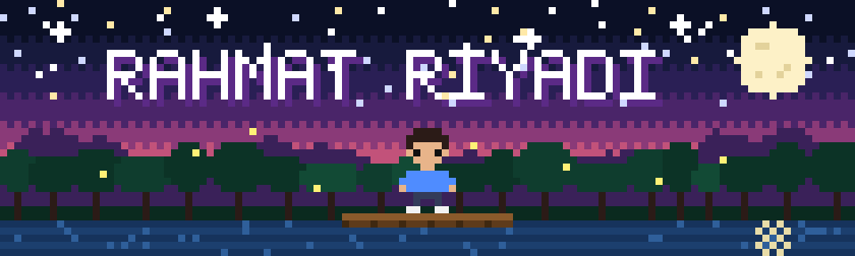
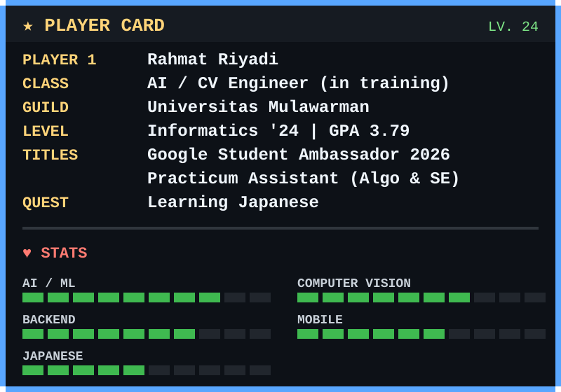

  

  

  
  
  

  
  
  
  
  

## 🎮 Player Card

  

Informatics student at Universitas Mulawarman, Samarinda (East Kalimantan).
I build AI for real problems around me: satellite imagery for forest fires and mining in Kalimantan,
nutrition-label scanning, and learning tools for kids. I also run **Ofi Labs**, a small team of AI agents
that helps me ship study tools and products.
Long-term goal: become an AI researcher and contribute to education and the environment in Indonesia.

## 📜 Quest Log

- 🔥 Researching burned-area mapping in East Kalimantan (Sentinel-2, dNBR + U-Net)
- ⛏️ Detecting new mining areas from satellite imagery with a custom CNN
- 🤖 Building multi-agent workflows and Claude Code skills (Claude + Gemini)
- 📱 Shipping Flutter apps: JeliLabel (nutrition scanner) and Insap (student budgeting)
- 🇯🇵 Studying Japanese

## 🎒 Inventory

  

## 🚀 Featured Projects

| Kategori | Stack | Proyek |
|:--|:--|:--|
| 🛰️ **AI & Remote Sensing** |    | [Peta Tambang Kaltim](https://github.com/riyadiambis/peta-tambang-kaltim) [Web Karhutla Kaltim](https://github.com/riyadiambis/web-karhutla-kaltim) [Nutrition Fact Detection CNN](https://github.com/riyadiambis/Nutrition-Fact-Detection-CNN) |
| 🤖 **AI Tooling** |   | [Claude Delegator](https://github.com/riyadiambis/claude-delegator): Claude Code skills that save tokens by delegating work to Gemini and picking the right model/effort |
| 🎮 **Game Edukasi** |   | [Zombaca](https://github.com/riyadiambis/Zombaca) [Slime Lompat Huruf](https://github.com/riyadiambis/Game-Slime-Lompat-Huruf) [Kapibara Cari Huruf](https://github.com/riyadiambis/kapibara-cari-huruf) [Mengenal Huruf](https://github.com/riyadiambis/Mengenal-Huruf-Web) |
| 📱 **APK / Mobile** |   | [JeliLabel Mobile](https://github.com/riyadiambis/jelilabel-mobile) [Insap App](https://github.com/riyadiambis/Insap-App-Flutter) |

👉 [Lihat semua repository](https://github.com/riyadiambis?tab=repositories)

## 🐍 Contribution Snake

  <picture>
    <source media="(prefers-color-scheme: dark)" srcset="https://raw.githubusercontent.com/riyadiambis/riyadiambis/output/github-snake-dark.svg" />
    <source media="(prefers-color-scheme: light)" srcset="https://raw.githubusercontent.com/riyadiambis/riyadiambis/output/github-snake.svg" />
    
  </picture>

<i>"Make it work, make it right, make it fast." - Kent Beck</i>

